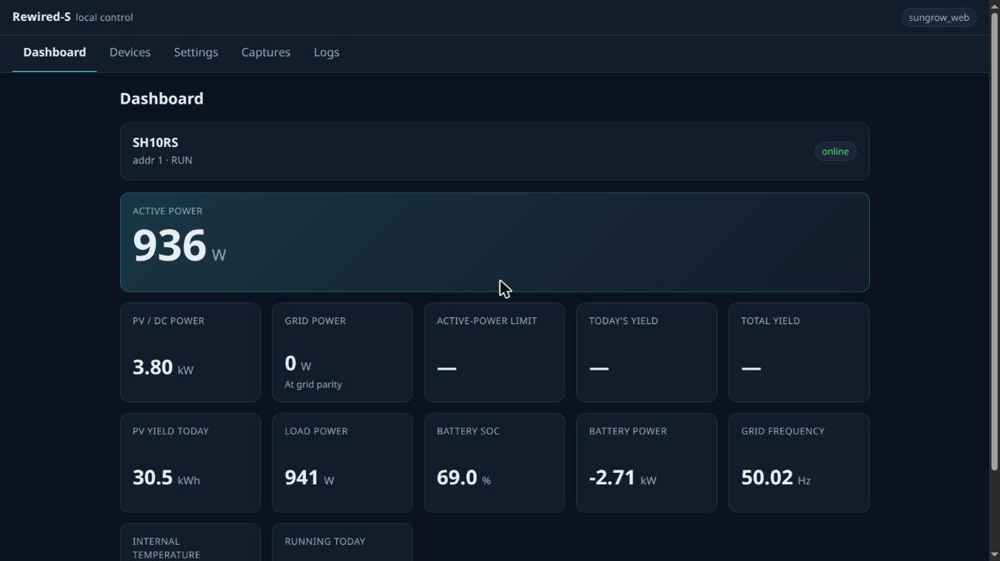
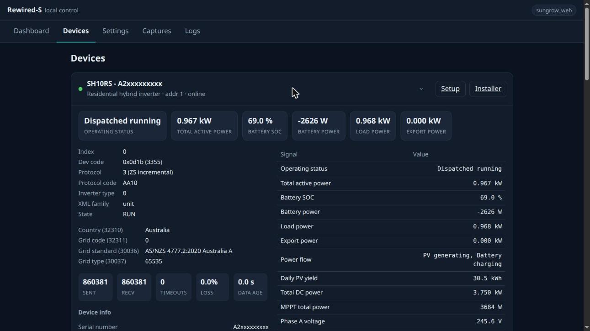
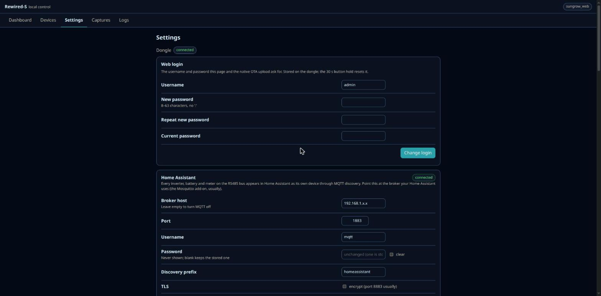

# Rewired-S

[](https://github.com/NickStallman/Rewired-S/actions/workflows/ci.yml)
[](https://github.com/NickStallman/Rewired-S/releases)
[](LICENSE)
[](https://esphome.io)
[](https://github.com/sponsors/NickStallman)

Open-source replacement firmware for the **Sungrow WiNet-S and WiNet-S2** communication dongles,
built on [ESPHome](https://esphome.io). The dongle that plugs into your inverter becomes a local,
Home Assistant friendly gateway with inverter and battery control, while everything the stock
dongle did for other people (the iSolarCloud connection, the installer app, Modbus-TCP) keeps
working.

> [!WARNING]
> **Alpha software.** Tested daily on an SH10RS with two SBR192 stacks and an SG5.0RS; the SH15T
> is verified for reads by a user. Other models are expected to work; see the
> [hardware compatibility chart](docs/compatibility.md) and [limitations](docs/limitations.md),
> keep the way back to the stock firmware in mind ([docs/back_to_stock.md](docs/back_to_stock.md)),
> and report what you find.

## What you get

- **Every device in Home Assistant, locally.** The inverter, each battery stack and the meter
  appear through MQTT discovery as their own devices, with the same entity scheme as the
  [Winet Extractor add-on](https://github.com/NickStallman/home-assistant-repo/tree/main/winet-extractor):
  `sensor.sh10rs_<serial>_battery_soc`. Values update every second for power and every five
  seconds for MPPT and battery data, polled straight from the RS485 bus.
- **Control, with a safety gate.** EMS mode, forced charge and discharge, SOC limits, export
  limit, string-inverter power limit, start/stop. Every write passes an allow-list and range
  check, is read back, and only happens while the dongle's **Inverter writes enabled** switch is
  on (off by default).
- **A web UI on the dongle.** Dashboard, every signal of every device, the installer protection
  settings and the country / grid-code setup with a preview before anything is written,
  diagnostic captures (I-V curves, grid waveforms, fault recordings) with in-browser viewers,
  settings and logs.
- **iSolarCloud still works**, and is now a choice: the dongle presents itself to the cloud as
  the stock unit with its own serial number, so the Sungrow app and portal keep working. A
  **Cloud uplink** switch turns the connection off, and a separate **Cloud writes** switch
  (default off) decides whether the cloud may change inverter settings.
- **Modbus-TCP on port 502**, so [mkaiser's integration](https://github.com/mkaiser/Sungrow-SHx-Inverter-Modbus-Home-Assistant),
  SunGather and friends keep working against the usual register maps, with the same write gate.
- **Diagnostics built in.** A reset journal that survives reboots, a one-click diagnostics
  report with serial numbers removed, and a **Send diagnostics** button that is also how a new
  inverter model gets supported ([usage reporting](docs/analytics.md)).

| Dashboard | Device signals and controls | Settings |
|---|---|---|
|  |  |  |

More screenshots: [devices](docs/images/devices.jpg), [installer settings](docs/images/installer.jpg),
[grid-code setup](docs/images/setup.jpg), [captures](docs/images/captures.jpg),
[boot slots and cloud identity](docs/images/settings-boot-slots.jpg).

## Hardware

| Dongle | SoC | Network | Status |
|---|---|---|---|
| WiNet-S (V200) | ESP32, 4 MB PSRAM | Wi-Fi | ✅ |
| WiNet-S (V200) | ESP32, 4 MB PSRAM | Ethernet (DP83848) | ✅ |
| WiNet-S2 (SV300) | ESP32-S3, 8 MB PSRAM | Wi-Fi | ✅; pre-built image and updater install 🟢 |
| WiNet-S2 (SV300) | ESP32-S3, 8 MB PSRAM | Ethernet (W5500) | 🟢 |

Legend and evidence: [compatibility chart](docs/compatibility.md).

Inverters and batteries: every inverter the WiNet-S supports works, because the firmware polls
each device from the register table of the protocol type it reports rather than by model name;
the [compatibility chart](docs/compatibility.md) lists every class, whether its power-stage
acceptance ranges are known, and how far it has been verified. In short: SH-RS hybrids, SG-RS
string inverters, SBR batteries and a DTSU666 on the meter port are ✅; the SH15T is 🟢 for reads.
SH-RT and SG-RT models, SBH batteries, meters on their own RS485 address, EV chargers and the
Energy Bridge are 🟡/⚪.

## Quick start

Pre-built image through the dongle's own updater, no tools on the dongle, no soldering, both
dongles. The stock app stays in the other slot; **Settings → Boot slots → Boot other slot** is
the way back.

1. Download your entry's `.zip` package and `publicKey_V1.pem` from the
   [latest release](https://github.com/NickStallman/Rewired-S/releases) into an empty folder.
   Entries: `winet-s-prebuilt`, `winet-s-ethernet-prebuilt`, `winet-s2-prebuilt`,
   `winet-s2-ethernet-prebuilt`.
2. On a computer on the same network (Python 3.11+):

   ```sh
   git clone https://github.com/NickStallman/Rewired-S.git && cd Rewired-S
   python3 -m venv .venv && source .venv/bin/activate && pip install -r tools/requirements.txt
   python3 -I tools/deploy_debug.py import-key --host <dongle-ip> --pubkey <folder>/publicKey_V1.pem
   python3 -I tools/fake_iconfig_server.py --dist <folder>
   ```

3. From a browser **on that computer**, log in to the dongle's stock web UI as `admin` and open
   **System → System maintenance → System update → iConfig update package**. Start it and wait
   two to three minutes; the dongle reboots into Rewired-S.
4. Wi-Fi images: join the `rewired-s-xxxxxx` network (password `rewired-s-setup`) and enter your
   Wi-Fi. Ethernet images take a DHCP lease.
5. Open `http://<dongle>/` (`admin` / `rewired-s`), set the MQTT broker and a new password on
   the Settings page. Home Assistant discovers the inverter, batteries and meter.

Details, checks and recovery: [installing through the updater](docs/install_ota.md); Windows,
macOS and Linux setup of the tools: [running the tools](docs/tools_setup.md); what the pre-built
images do: [pre-built images](docs/prebuilt.md).

Other ways in: over the [serial pads](docs/install_serial.md) (WiNet-S only; the
[install page](https://nickstallman.github.io/Rewired-S/) has ESP Web Tools for it), or
[compile your own image with ESPHome](docs/esphome.md) for compiled-in credentials, a site file
with your own options, the native-entities alternative to MQTT, or the debug build.

## Home Assistant

The dongle itself is a native ESPHome device (the writes gate, the cloud switches, reset reason,
restart buttons). Everything behind it comes through **MQTT discovery**, because which devices
sit on the RS485 bus is only known at runtime: ESPHome entities are fixed when the firmware is
compiled, MQTT discovery lets the firmware publish one Home Assistant device per inverter,
battery stack or meter it actually finds, keyed by model and serial number. The MQTT broker is
the only extra service you need. Why, what gets published and how to build dashboards:
[docs/home_assistant.md](docs/home_assistant.md). Ready-made dashboards: [dashboards/](dashboards/).

Prefer Modbus? Leave the MQTT settings empty and point mkaiser's package or SunGather at the
dongle's port 502. Writes go through the same **Inverter writes enabled** gate.

## Going back to stock

Three ways, none of which touches the dongle's identity or settings:

1. **Boot other slot** on the web UI, while the stock app is still in the other slot.
2. Extract the app image from an official Sungrow package you download yourself
   (`tools/sgu.py extract`) and send it with ESPHome's OTA (not yet run on hardware).
3. Over serial on the WiNet-S, from your backup or from that extracted image.

Details and what is preserved: [docs/back_to_stock.md](docs/back_to_stock.md).

## Usage reporting and diagnostics

Once a day the dongle sends an anonymous usage report to a collector run by the project
(firmware and board versions, the models and firmware versions of the connected devices, which
features are on, uptime, memory, reset reason) and short error events when something notable
happens. The dongle is identified by a hash of its serial number; serials, addresses, host names
and Wi-Fi names are never sent. It exists so that problems and new hardware show up without
anyone filing an issue. The **Usage reporting** switch turns it off.

**Send diagnostics** on the Settings page uploads a report of the build, the detected devices
with their identification reply and register map, feature state, memory and the recent log,
with serial numbers, the node name and addresses replaced. Quote the reference it shows in an
issue, or attach the **Download report** file instead. For a device that is not on the
compatibility chart this report is everything needed to add it. Full description:
[docs/analytics.md](docs/analytics.md).

## Documentation

| | |
|---|---|
| [Compatibility](docs/compatibility.md) | dongles, inverter families, batteries and accessories, with status |
| [Install through the updater](docs/install_ota.md) | signed package, key import, LAN pull route, go / no-go checks |
| [Install over serial](docs/install_serial.md) | WiNet-S pads, backup, flashing, ESP Web Tools |
| [Running the tools](docs/tools_setup.md) | Python setup and the tool commands on Windows, macOS and Linux |
| [Pre-built images](docs/prebuilt.md) | setup network, default login, MQTT settings, updates |
| [ESPHome](docs/esphome.md) | compiling your own image: setup, entries, site files, secrets, options, make targets |
| [Home Assistant](docs/home_assistant.md) | MQTT discovery, entity names, the dongle's own entities, dashboards |
| [Control](docs/control.md) | every writable setting, the safety model, the write paths |
| [Back to stock](docs/back_to_stock.md) | three ways back and what is preserved |
| [Cloud identity](docs/cloud_identity.md) | how the dongle presents itself to iSolarCloud |
| [Usage reporting](docs/analytics.md) | what is sent, when, and how to turn it off |
| [Debug build](docs/debug_build.md) | the read-only build for new hardware, flash backup, bus tools |
| [Limitations](docs/limitations.md) | what is unverified, different from stock, or deliberately left out |
| [Data format](docs/data_format.md) | the register, point and profile tables, and how to add a device family |
| [Device types, Setup, Installer](docs/device_types_setup_installer.md) · [Registers](docs/inverter_registers.md) · [Battery](docs/battery_sbr.md) · [Captures](docs/capture.md) · [Update rates](docs/update_rates.md) · [Board pins](docs/board_pins.md) | reference |

How the dongles, inverters, batteries and the cloud protocol work is documented separately in
**[SG-Docs](https://github.com/NickStallman/SG-Docs)**; this repository cites it wherever a
protocol or hardware fact matters.

## Development

```sh
python3 -m venv .venv && .venv/bin/pip install esphome==2026.9.1 -r tools/requirements.txt
cp secrets.yaml.example secrets.yaml
make            # host suites, web suite, generated files up to date
make config     # validate every entry
make compile    # build every entry
```

Layout: `winet-s*.yaml` entries, `boards/` pins and partition tables, `common/` packages,
`components/` the ESPHome components, `data/` the project's device tables, `tools/` generators and
the `.sgu` tooling, `dashboards/`, `docs/`, `tests/`. [CONTRIBUTING.md](CONTRIBUTING.md) covers
the rules (no stock files, no serials) and how to add a device family.

## Support the project

Rewired-S is free and will stay free. If it is useful to you,
[sponsoring](https://github.com/sponsors/NickStallman) helps pay for the inverters, batteries and
dongles that testing new hardware needs.

## Licence

GPL-3.0 ([LICENSE](LICENSE)). Third-party components are listed in
[THIRD_PARTY_NOTICES.md](THIRD_PARTY_NOTICES.md). Sungrow, iSolarCloud, WiNet, SH10RS, SG5.0RS
and SBR are trademarks or product names of Sungrow Power Supply Co., Ltd. This project is not
affiliated with or endorsed by Sungrow.
